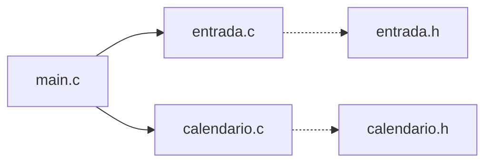
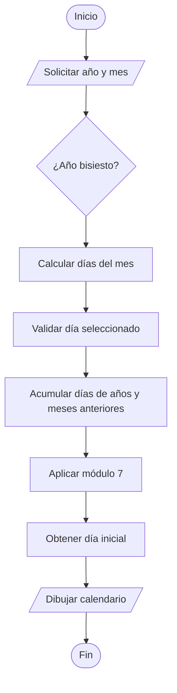

<div align="center">

# Calendario en C

**Calendario interactivo para consola, escrito en C puro y con algoritmos de fechas propios.**

<br>


<br>

[Características](#características) •
[Vista previa](#vista-previa) •
[Compilación](#compilación-y-ejecución) •
[Algoritmo](#funcionamiento-del-algoritmo) •
[Hoja de ruta](#hoja-de-ruta)

</div>

---

## Acerca del proyecto

Aplicación de consola que genera **calendarios mensuales** a partir de un año y un mes ingresados por el usuario.

Todo el cálculo de fechas (años bisiestos, días por mes y día de la semana) está implementado desde cero, **sin depender de librerías externas** como `<time.h>`. El objetivo es entender cómo funciona un calendario por dentro, no solo mostrarlo.

---

## Características

<table>
<tr>
<td valign="top" width="50%">

### Lógica
- Generación de calendarios mensuales
- Cálculo automático de años bisiestos
- Determinación del primer día de cada mes
- Validación de fechas ingresadas
- Selección de un día específico

</td>
<td valign="top" width="50%">

### Presentación
- Resaltado del día seleccionado
- Fines de semana diferenciados por color
- Título centrado automáticamente
- Bordes decorativos en consola
- Colores mediante códigos ANSI

</td>
</tr>
<tr>
<td colspan="2" align="center">

**Arquitectura modular** &nbsp;·&nbsp; **Compilación automatizada con Makefile**

</td>
</tr>
</table>

---

## Vista previa

```text
+---------------------+
|   Noviembre 2026    |
+---------------------+
|Lu Ma Mi Ju Vi Sa Do |
+---------------------+
|                   1 |
| 2  3  4  5  6  7  8 |
| 9 10 11 12 13 14 15 |
|16 17 18 19 20 21 22 |
|23 24 25 26 27 28 29 |
|30                   |
+---------------------+

Fecha seleccionada: 18/11/2026
```

> [!NOTE]
> En la terminal, el día seleccionado y los fines de semana se muestran destacados con colores ANSI. El bloque anterior es solo una representación en texto plano.

---

## Estructura del proyecto

```text
Calendario/
├── main.c           → Punto de entrada y flujo principal
├── entrada.c        → Captura y validación de datos
├── entrada.h        → Declaraciones del módulo de entrada
├── calendario.c     → Algoritmos de fechas y representación visual
├── calendario.h     → Declaraciones del módulo de calendario
├── Makefile         → Automatización de la compilación
├── .gitignore       → Exclusión de archivos generados
└── README.md
```



---

## Requisitos

| Herramienta | Descripción |
|:---|:---|
| **GCC** | Compilador de C (MinGW en Windows) |
| **Make** | GNU Make o `mingw32-make` |
| **Terminal ANSI** | Windows Terminal, PowerShell moderno o similar |

---

## Compilación y ejecución

### Con Make (recomendado)

| Acción | Comando |
|:---|:---|
| Compilar | `mingw32-make` |
| Compilar y ejecutar | `mingw32-make run` |
| Limpiar archivos generados | `mingw32-make clean` |

Una vez compilado, ejecuta el programa con:

```powershell
.\calendario.exe
```

<details>
<summary><b>Compilación manual con GCC (sin Make)</b></summary>

<br>

```bash
gcc -Wall -Wextra -Wpedantic main.c entrada.c calendario.c -o calendario
```

Las opciones `-Wall -Wextra -Wpedantic` activan advertencias adicionales para mantener un código limpio y conforme al estándar.

</details>

---

## Funcionamiento del algoritmo

El programa aplica las reglas del **calendario gregoriano** para obtener la cantidad de días de cada mes y el día de la semana en que comienza.



<details>
<summary><b>Detalle de los pasos</b></summary>

<br>

1. Solicita el año y el mes al usuario.
2. Determina si el año es bisiesto.
3. Calcula la cantidad de días del mes.
4. Valida el día seleccionado.
5. Acumula los días de los años y meses anteriores.
6. Aplica el operador módulo 7 para determinar el día inicial.
7. Genera la representación visual del calendario.

**Regla del año bisiesto:** un año es bisiesto si es divisible por 4, excepto los divisibles por 100, salvo que también lo sean por 400.

</details>

> [!TIP]
> La posición inicial se calcula tomando como referencia el **1 de enero del año 1**, que corresponde a un **lunes** en el calendario gregoriano proléptico.

---

## Tecnologías y conceptos

<div align="center">


</div>

| Área | Conceptos aplicados |
|:---|:---|
| **Paradigma** | Programación estructurada y modular |
| **Lenguaje** | Funciones, punteros, arreglos y cadenas de caracteres |
| **Lógica** | Operadores lógicos y aritméticos, algoritmos de fechas |
| **Interfaz** | Códigos de escape ANSI |
| **Herramientas** | GNU Make, Git y GitHub |

---

## Hoja de ruta


<table>
<tr>
<td valign="top" width="50%">

### Completado
- [x] Validación de meses y años
- [x] Cálculo de días por mes
- [x] Identificación de años bisiestos
- [x] Validación de fechas
- [x] Cálculo del día inicial
- [x] Generación del calendario mensual
- [x] Modularización del código
- [x] Automatización de la compilación
- [x] Resaltado de días seleccionados
- [x] Colores y bordes decorativos

</td>
<td valign="top" width="50%">

### Próximamente
- [ ] Validación robusta de entradas no numéricas
- [ ] Optimización del algoritmo de fechas
- [ ] Menú interactivo
- [ ] Navegación entre meses y años
- [ ] Visualización del calendario anual
- [ ] Registro de eventos y recordatorios
- [ ] Persistencia de datos mediante archivos
- [ ] Pruebas unitarias

</td>
</tr>
</table>

---

## Objetivo del proyecto

Reforzar los fundamentos de programación en C mediante el desarrollo progresivo de una aplicación funcional, aplicando buenas prácticas de **organización**, **modularización**, **diseño de algoritmos** y **control de versiones**.

---

<div align="center">

## Autor

**Ignacio Contreras Norambuena**

Proyecto personal de aprendizaje y práctica de programación en C.

</div>
